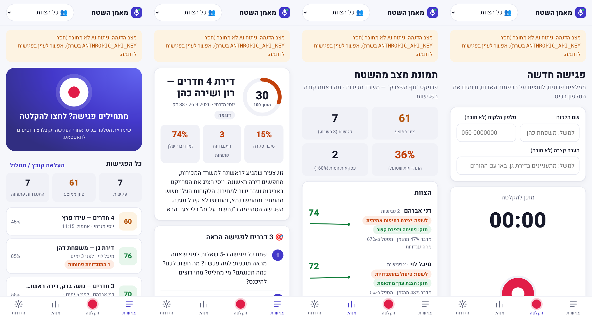

# מאמן השטח 🎙️ — AI לפגישות מכירה פנים מול פנים

בישראל יש הרבה כלים שמנתחים שיחות טלפון. **אבל מה עם מי שמוכר פנים מול פנים?** משרדי מכירות של דירות, סוכנויות רכב, אולמות תצוגה של מטבחים, סוכני ביטוח, אולמות אירועים. הפגישה נגמרת, ואף אחד לא זוכר בדיוק מה נאמר בה.

**מאמן השטח** פותר את זה:

1. **לפני הפגישה** איש המכירות לוחץ "הקלטה" ומכניס את הטלפון לכיס (יש "מצב כיס" עם מסך שחור שחוסך סוללה).
2. **אחרי הפגישה** השיחה מתומללת בעברית ומנותחת לפי הפרמטרים שהמנהל קבע.
3. **תוך דקה** איש המכירות מקבל לוואטסאפ ציון, 3 טיפים לפגישה הבאה, ותשובות מוכנות להתנגדויות שנשארו פתוחות.
4. **המנהל** רואה סוף סוף מה קורה בשטח: ציון לכל איש מכירות לאורך זמן, החולשה של כל אחד, אילו התנגדויות חוזרות ואילו לא מקבלות מענה.



## מה יש בכל ניתוח

| | |
|---|---|
| **ציון 0–100** | ממוצע משוקלל של הקריטריונים שהמנהל קבע. החישוב נעשה בשרת, כך שהוא עקבי |
| **ציון לכל קריטריון** | 0–10, עם ציטוט מהשיחה שמבסס אותו ומשפט אחד על מה לשפר |
| **התנגדויות** | כל התנגדות: מה הלקוח אמר, האם טופלה (מלא / חלקי / לא), ומשפט שאפשר להגיד ללקוח מילה במילה |
| **הזדמנויות שפוספסו** | סימני קנייה שאיש המכירות לא ניצל |
| **יחס דיבור ושאלות** | כמה אחוז מהזמן דיבר איש המכירות, וכמה שאלות שאל |
| **פרופיל לקוח** | צרכים, תקציב, מקבלי החלטה, לוח זמנים, סנטימנט |
| **סיכוי סגירה וצעדים הבאים** | |
| **הודעת המשך ללקוח** | מוכנה לשליחה בוואטסאפ בלחיצה אחת |
| **תמלול מחולק לדוברים** | עם נגן של ההקלטה |

**תחומים מוכנים** (כל אחד עם קריטריונים מותאמים): נדל"ן, רכב, מטבחים, ביטוח, אולמות אירועים, כללי. המנהל יכול לערוך, להוסיף ולתת משקל לכל קריטריון.

## הרצה

```bash
cd field-coach
npm install
cp .env.example .env      # להכניס ANTHROPIC_API_KEY
npm start                 # http://localhost:3000
```

בלי מפתחות האפליקציה עולה ב**מצב הדגמה**, עם צוות לדוגמה ("נוף הפארק", 3 אנשי מכירות, 7 פגישות מנותחות) כדי לראות את כל המסכים.

| משתנה | חובה? | מה הוא עושה |
|---|---|---|
| `ANTHROPIC_API_KEY` | כן | ניתוח הפגישה עם Claude (`claude-opus-5-5`, פלט מובנה עם Zod) |
| `TRANSCRIBE_API_KEY` | לא | תמלול ההקלטה בשרת. עובד עם כל endpoint תואם OpenAI: OpenAI ‏`gpt-4o-transcribe`, או Groq ‏`whisper-large-v3` (זול ומהיר). בלי המפתח משתמשים בתמלול החי של הדפדפן (Chrome) |
| `TWILIO_*` | לא | שליחה אוטומטית לוואטסאפ אחרי כל פגישה. בלי זה, כפתור "שלח לוואטסאפ" פותח את WhatsApp עם ההודעה מוכנה (`wa.me`) |

**Docker:** `docker build -t field-coach . && docker run -p 3000:3000 --env-file .env -v fc-data:/data field-coach`

כדי להקליט מהטלפון צריך HTTPS (הדפדפן לא נותן גישה למיקרופון בלי HTTPS). אפשר לפרוס ל-Render / Railway / Fly, או להריץ מקומית עם `npx localtunnel --port 3000`. ב-Android וב-iPhone אפשר "להוסיף למסך הבית", והאפליקציה תיפתח כמו אפליקציה רגילה (PWA).

## ארכיטקטורה

```
טלפון (PWA, MediaRecorder + Web Speech)  ──►  Node/Express
                                               ├─ lib/transcribe.js  תמלול עברית (OpenAI-compatible)
                                               ├─ lib/analyze.js     Claude + סכמת Zod → ניתוח מובנה
                                               ├─ lib/stats.js       אגרגציות לדשבורד המנהל
                                               ├─ lib/whatsapp.js    wa.me / Twilio
                                               └─ lib/store.js       JSON על דיסק (data/)
```

- בלי שלב build: צד הלקוח הוא HTML/CSS/JS רגיל, עם RTL מלא ומצב כהה.
- ההקלטה נשמרת בשרת, ואם העיבוד נכשל אפשר ללחוץ "נסו שוב". אם ההעלאה נכשלת, ההקלטה נשמרת במכשיר.
- עיבוד שנקטע באמצע (למשל אם השרת אותחל) ממשיך אוטומטית כשהשרת עולה.

## בדיקות

```bash
npm test   # בדיקת קצה-לקצה מול Claude API מדומה + בדיקות יחידה
```

## השלב הבא (אחרי ה-MVP)

- זיהוי דוברים אקוסטי (diarization) במקום הסקה מהתוכן
- הקלטה ברקע ב-iOS באמצעות אפליקציה נייטיב (Capacitor)
- התחברות למשתמשים והרשאות מנהל / איש מכירות, ושמירת הנתונים ב-Postgres
- סיכום שבועי למנהל בוואטסאפ: "יוסי השתפר ב-30 נקודות בסגירה"
- חיבור ל-CRM (Monday, Salesforce) לעדכון אוטומטי של הליד
